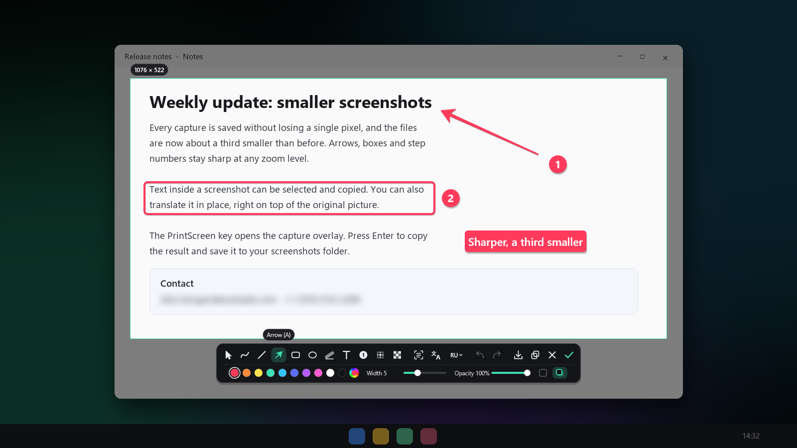
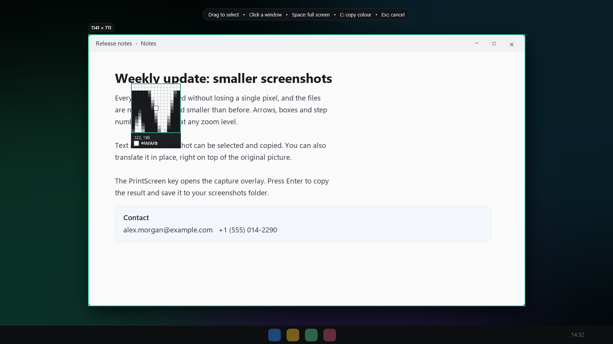
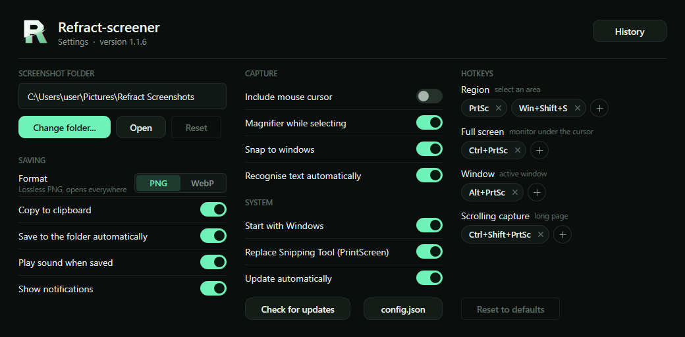

<p align="center">
  
</p>

<h1 align="center">Refract Screener</h1>

<p align="center">
  A screenshot tool for Windows 10 and 11. It takes PrintScreen and Win+Shift+S over from Snipping Tool.<br>
  Written in Rust on Win32, Direct2D and WinRT. One 2 MB executable, no runtime needed.
</p>

<p align="center">
  
</p>

## What it does

- **Captures** a region, a window or a whole monitor at the screen's real resolution, so nothing is scaled. A magnifier shows the pixel under the cursor and its colour.
- **Annotates** with arrows, lines, rectangles, ellipses, pen, highlighter, text, numbered steps, blur and pixelate. Every shape stays editable until you finish: move it, resize it, change its colour, undo.
- **Reads text** with the OCR engine built into Windows. Drag over words to select them, then press Ctrl+C. It works offline.
- **Translates in place**: the translation is drawn over the original text and can be saved into the image.
- **Takes long screenshots**: select part of a page or a window and scroll it as usual. The app stitches what scrolls by into one tall image, up to 30 000 px. A sticky header or footer appears once. See [Scrolling capture](#scrolling-capture).
- **Saves losslessly and small.**
  - PNG goes through [oxipng](https://github.com/oxipng/oxipng). It is about 30% smaller than the PNG Windows writes.
  - Lossless WebP is optional. It is about 45% smaller.
  - The clipboard gets both a DIB and a PNG.
- **Keeps a history** of the last 500 shots: a grid of previews where you can open, copy again, show in the folder, share or delete any of them.
- **Shares a link** when the build has a server: the shot is uploaded, a short link goes to the clipboard, and the link stops working after 30 days or when you delete it. See [Share links](#share-links).
- **Replaces Snipping Tool** while it is installed. A small background process holds PrintScreen and Win+Shift+S even when the app is closed, and closes Snipping Tool if it starts. Turning this off in the settings gives the keys back to Windows.

| Selecting a region | Copying text |
| --- | --- |
|  |  |

| Translation over the original | Settings |
| --- | --- |
|  |  |

## Install

You need Rust (MSVC toolchain) and the Windows 10/11 SDK, which Visual Studio Build Tools include.

```
cargo build --release
```

Then run:

```
target\release\refract-screener.exe --install
```

The app installs for the current user, with no admin rights:

- it copies itself to `%LOCALAPPDATA%\Programs\Refract-screener`;
- it starts with Windows;
- it turns off "Print screen key opens Snipping Tool";
- it adds a Start menu entry and an entry in Settings > Apps.

To uninstall, use Settings > Apps, or run:

```
refract-screener.exe --uninstall
```

Uninstalling restores everything it changed. Screenshots and settings are kept.

Windows Security "Controlled folder access" blocks unknown programs from writing to Pictures. If it is on, the app saves to `%USERPROFILE%\Refract Screenshots` instead and offers to add itself to the allowed list.

## Keys

| Key | Action |
| --- | --- |
| PrintScreen, Win+Shift+S | Select a region |
| Ctrl+PrintScreen | Monitor under the cursor, no editor |
| Alt+PrintScreen | Active window, no editor |
| Ctrl+Shift+PrintScreen | Scrolling capture |

You can change these keys under **Hotkeys** in the settings. Click a shortcut, then press the new one: any keys work, including Win and PrintScreen. **+** adds another shortcut, **×** removes one, and **Reset to defaults** restores them all. Esc cancels. A shortcut used twice is shown in red, and only the first action gets it. Changes take effect at once, in the app and in the background key guard.

In the editor:

| Key | Action |
| --- | --- |
| V P L A R E M T N B X | Select, pen, line, arrow, rectangle, ellipse, highlighter, text, step number, blur, pixelate |
| 1–0 | Palette colours |
| I | Pick a colour from the screen |
| Wheel or [ ] | Size |
| Ctrl+wheel | Opacity |
| Shift | 45° lines, squares and circles |
| O | Text selection mode |
| Ctrl+T | Translate |
| Ctrl+A | Select all text (in text mode) |
| Enter | Copy and save |
| Ctrl+C | Copy (text in text mode) |
| Ctrl+S | Save to the folder |
| Ctrl+Shift+S | Save as |
| Ctrl+Shift+C | Share link (builds with a server) |
| Ctrl+Z, Ctrl+Y | Undo, redo |
| Esc, right click | Cancel |

## Scrolling capture

Press Ctrl+Shift+PrintScreen or choose **Scrolling capture** in the tray menu. Drag over the part of the page to capture, or click a window. To capture an area you are already editing, use the scrolling capture button on the toolbar.

Then scroll down yourself, with the wheel, the scroll bar or the keyboard. The app looks at the area about 30 times a second and adds every new part. A panel beside the area shows the picture growing as one image, like a phone panorama, with a frame around the part that is on screen now. The panel never appears in the frames.

Scrolling back up is ignored. If you scroll too fast, the panel turns red and asks you to scroll back to where it stopped, and the capture goes on from there. Press Esc or click **Done** to finish, and the editor opens. Capture also stops at 30 000 px.

Frames are matched by their rows. Rows that stay in place at the top and bottom, such as a sticky header, a footer or a cookie bar, are left out of the matching and appear once in the result. Parts beside the page that stay in place, such as a site menu, a side panel or another window, are left out of the matching too. So is anything that changes on its own, such as a video playing next to the page. The result is cut to the part that scrolled. So you can select a whole window or the whole screen. Matching still works when the page shows through a translucent window background.

The result opens in the editor with every tool. A tall picture is shown scaled and scrolled:

| Key | Action |
| --- | --- |
| Wheel, Page Up/Down, Home, End | Scroll |
| Ctrl+wheel, Ctrl+Plus, Ctrl+Minus | Zoom |
| Ctrl+0, Ctrl+1 | Whole picture, 100% |
| Middle button drag | Pan |
| [ ] | Size of the current tool |

Dragging near the top or bottom edge scrolls the picture. The saved file is the full picture at its real resolution.

## History

Open it from the tray menu (**History...**), with the **History** button in the settings, or with `refract-screener.exe --history`. Every saved or shared shot is listed, newest first. The index is `%LOCALAPPDATA%\Refract-screener\history.json`. It keeps up to 500 entries; the files themselves are never removed when an entry drops out.

| Key | Action |
| --- | --- |
| Arrows, Page Up/Down, Home, End | Move the selection |
| Enter, double click | Open |
| Ctrl+C | Copy the image again |
| Ctrl+Shift+C | Share link, or copy the link if it already exists |
| Delete | Move the file to the Recycle Bin (and delete its link) |
| Right click | All actions |

Each shot has one JPEG preview, up to 640 px. The notification shows it, and the History window reuses it. The window decodes only the previews on screen, on a background thread and at card size, and keeps at most 96 of them. Entries whose file was deleted are dropped when the window opens, unless their link still works.

## Settings

Open them by clicking the tray icon, or by opening Refract-screener from the Start menu. Settings also open right after installing. The window covers:

- the screenshot folder;
- the format;
- what happens after a capture;
- capture options;
- start with Windows;
- replacing Snipping Tool;
- updates;
- hotkeys.

The window is 1040 × 512 px at 100% scale, so it fits a 1366 × 768 laptop screen at 125%.

Everything else is in `%APPDATA%\Refract-screener\config.json`:

- file name template
- palette and accent colour
- UI scale and font
- OCR language
- translation languages and a Google Cloud Translation API key

Without a key, translation uses the public Google Translate endpoint.

## Updates

Auto-update is off unless you build with an update server:

```
set REFRACT_UPDATE_URL=https://your.server
cargo build --release
```

The app checks `GET {server}/api/screens/manifest` on start, every hour and after the PC wakes up. The manifest looks like this:

```json
{
  "version": "1.2.0",
  "size": 2121728,
  "sha256": "…",
  "url": "/api/screens/app",
  "setup": { "size": 465408, "sha256": "…", "url": "/api/screens/setup" }
}
```

A newer build is downloaded and checked against the size and SHA-256. The app then asks you to restart: a small card in the corner and a notification with **Restart now**. `RefractScreenerSetup.exe` is a 0.5 MB online installer built from the same crate. It reads the same manifest.

## Share links

Sharing uses the same server as updates (`REFRACT_UPDATE_URL`, or `update_url` in `config.json`). A build without one has no Share button and no share menu item.

The bytes uploaded are the ones written to the screenshot file, so a shot is encoded once. A PNG over the 15 MB limit is re-encoded as lossless WebP. Uploads run in the background; one that takes longer than a second shows a progress bar in a notification. When it is done, the link is on the clipboard and a notification shows the preview.

The server side is three endpoints:

```
POST   {server}/api/s           body: the PNG or WebP file
                                headers: Content-Type: image/png | image/webp, X-Refract-Client: screener/<version>
       -> 200 {"id": "Ab12Cd34Ef", "url": "https://…/s/Ab12Cd34Ef", "deleteToken": "…", "expires": "2026-12-15T10:20:30Z"}
DELETE {server}/api/s/<id>      header: X-Delete-Token: <deleteToken>   -> 200, or 404 if it is already gone
GET    {server}/s/<id>          a page with the image (Open Graph tags for chat previews), /s/<id>.png|.webp the file
```

The app treats 413 as "too large" and 429 as "too many uploads". The delete token is kept only in the local history.

## How it works

| Part | How |
| --- | --- |
| Capture | GDI `BitBlt` of the virtual desktop in a per-monitor-DPI-aware (v2) process |
| Editor | Direct2D on a full-screen window. The same drawing code renders the export, so the saved file matches what you saw. |
| Hotkeys | A low-level keyboard hook. Win+Shift+S has no off switch in Windows, so the hook is the only reliable way to take it. While you record a shortcut in the settings, the hook passes every key to the settings window instead of acting on it. |
| Scrolling capture | The area is read with `BitBlt` about 30 times a second while you scroll. Frames are matched by row hashes in strips of the columns that changed, and the shift most strips agree on wins, and by brightness edges when nothing matches exactly. The image is stitched as frames arrive, so only the last frame and the result are in memory. The editor keeps the tall picture in GPU tiles of 4096 rows, creates them only when they come into view, and computes blur and pixelate in bands. Export renders in strips straight into the output. |
| Text | `Windows.Media.Ocr`. Small text is read at 2× scale. Lines are grouped into paragraphs before translation, so sentences stay whole. |
| Files | oxipng with libdeflate, libwebp, WIC, and the clipboard formats `CF_DIB` and `PNG` |

The code is in `src/`:

- `overlay.rs`: the editor
- `paint.rs`: shapes
- `ocr.rs`: recognition and translation
- `encode.rs`: file formats and clipboard
- `guard.rs`: the background key guard
- `hotkey.rs`: the keyboard hook, shortcut parsing and recording
- `scroll.rs`: scrolling capture and stitching
- `update.rs`: updates
- `settings.rs`: the settings window
- `history.rs`: the history index and window
- `share.rs`: share links
- `net.rs`: HTTP over WinHTTP

Self-test (capture, every tool, a lossless round trip of every format, OCR and translation, the history index, an upload to a local test server, and stitching a synthetic long page with a sticky header and footer, checked byte for byte):

```
refract-screener.exe --selftest <folder>
```

## License

MIT, see [LICENSE](LICENSE). The Refract name and logo are not covered by the license.
