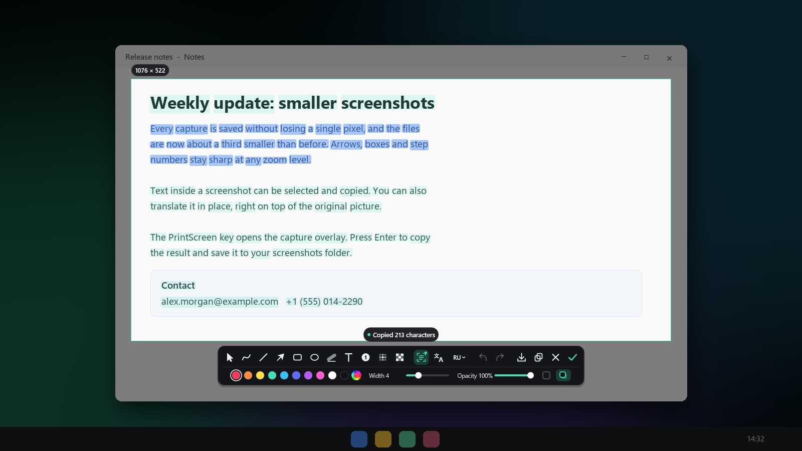
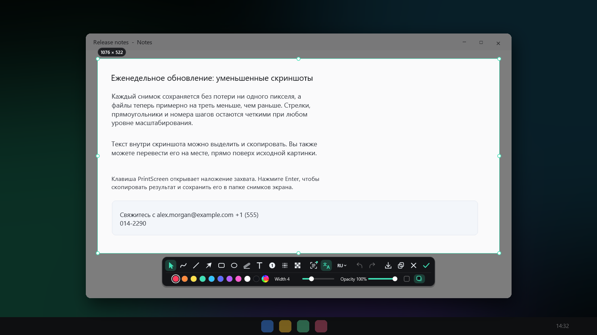

<p align="center">
  
</p>

<h1 align="center">Refract Screener</h1>

<p align="center">
  A screenshot tool for Windows 10 and 11. It takes PrintScreen and Win+Shift+S over from Snipping Tool.<br>
  Written in Rust on Win32, Direct2D and WinRT. One 2 MB executable, no runtime needed.
</p>

<p align="center">
  
</p>

## What it does

- **Captures** a region, a window or a whole monitor at the screen's real resolution, so nothing is scaled. A magnifier shows the pixel under the cursor and its colour.
- **Annotates** with arrows, lines, rectangles, ellipses, pen, highlighter, text, numbered steps, blur and pixelate. Every shape stays editable until you finish: move it, resize it, change its colour, undo.
- **Reads text** with the OCR engine built into Windows. Drag over words to select them, then press Ctrl+C. It works offline.
- **Translates in place**: the translation is drawn over the original text and can be saved into the image.
- **Saves losslessly and small.**
  - PNG goes through [oxipng](https://github.com/oxipng/oxipng). It is about 30% smaller than the PNG Windows writes.
  - Lossless WebP is optional. It is about 45% smaller.
  - The clipboard gets both a DIB and a PNG.
- **Replaces Snipping Tool** while it is installed. A small background process holds PrintScreen and Win+Shift+S even when the app is closed, and closes Snipping Tool if it starts. Turning this off in the settings gives the keys back to Windows.

| Selecting a region | Copying text |
| --- | --- |
|  |  |

| Translation over the original | Settings |
| --- | --- |
|  |  |

## Install

You need Rust (MSVC toolchain) and the Windows 10/11 SDK, which Visual Studio Build Tools include.

```
cargo build --release
```

Then run:

```
target\release\refract-screener.exe --install
```

The app installs for the current user, with no admin rights:

- it copies itself to `%LOCALAPPDATA%\Programs\Refract-screener`;
- it starts with Windows;
- it turns off "Print screen key opens Snipping Tool";
- it adds a Start menu entry and an entry in Settings > Apps.

To uninstall, use Settings > Apps, or run:

```
refract-screener.exe --uninstall
```

Uninstalling restores everything it changed. Screenshots and settings are kept.

Windows Security "Controlled folder access" blocks unknown programs from writing to Pictures. If it is on, the app saves to `%USERPROFILE%\Refract Screenshots` instead and offers to add itself to the allowed list.

## Keys

| Key | Action |
| --- | --- |
| PrintScreen, Win+Shift+S | Select a region |
| Ctrl+PrintScreen | Monitor under the cursor, no editor |
| Alt+PrintScreen | Active window, no editor |

In the editor:

| Key | Action |
| --- | --- |
| V P L A R E M T N B X | Select, pen, line, arrow, rectangle, ellipse, highlighter, text, step number, blur, pixelate |
| 1–0 | Palette colours |
| I | Pick a colour from the screen |
| Wheel or [ ] | Size |
| Ctrl+wheel | Opacity |
| Shift | 45° lines, squares and circles |
| O | Text selection mode |
| Ctrl+T | Translate |
| Ctrl+A | Select all text (in text mode) |
| Enter | Copy and save |
| Ctrl+C | Copy (text in text mode) |
| Ctrl+S | Save to the folder |
| Ctrl+Shift+S | Save as |
| Ctrl+Z, Ctrl+Y | Undo, redo |
| Esc, right click | Cancel |

## Settings

Open them from the tray icon (**Settings…**) or by running `refract-screener.exe --settings`. The window covers:

- the screenshot folder;
- the format;
- what happens after a capture;
- capture options;
- start with Windows;
- replacing Snipping Tool;
- updates.

Everything else is in `%APPDATA%\Refract-screener\config.json`:

- hotkeys
- file name template
- palette and accent colour
- UI scale and font
- OCR language
- translation languages and a Google Cloud Translation API key

Without a key, translation uses the public Google Translate endpoint.

## Updates

Auto-update is off unless you build with an update server:

```
set REFRACT_UPDATE_URL=https://your.server
cargo build --release
```

The app checks `GET {server}/api/screens/manifest` on start and then every 6 hours. The manifest looks like this:

```json
{
  "version": "1.2.0",
  "size": 2121728,
  "sha256": "…",
  "url": "/api/screens/app",
  "setup": { "size": 465408, "sha256": "…", "url": "/api/screens/setup" }
}
```

A newer build is downloaded and checked against the size and SHA-256. The app then asks you to restart: a small card in the corner and a notification with **Restart now**. `RefractScreenerSetup.exe` is a 0.5 MB online installer built from the same crate. It reads the same manifest.

## How it works

| Part | How |
| --- | --- |
| Capture | GDI `BitBlt` of the virtual desktop in a per-monitor-DPI-aware (v2) process |
| Editor | Direct2D on a full-screen window. The same drawing code renders the export, so the saved file matches what you saw. |
| Hotkeys | A low-level keyboard hook. Win+Shift+S has no off switch in Windows, so the hook is the only reliable way to take it. |
| Text | `Windows.Media.Ocr`. Small text is read at 2× scale. Lines are grouped into paragraphs before translation, so sentences stay whole. |
| Files | oxipng with libdeflate, libwebp, WIC, and the clipboard formats `CF_DIB` and `PNG` |

The code is in `src/`:

- `overlay.rs`: the editor
- `paint.rs`: shapes
- `ocr.rs`: recognition and translation
- `encode.rs`: file formats and clipboard
- `guard.rs`: the background key guard
- `update.rs`: updates
- `settings.rs`: the settings window

Self-test (capture, every tool, a lossless round trip of every format, OCR and translation):

```
refract-screener.exe --selftest <folder>
```
